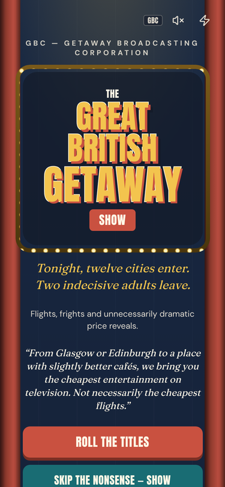
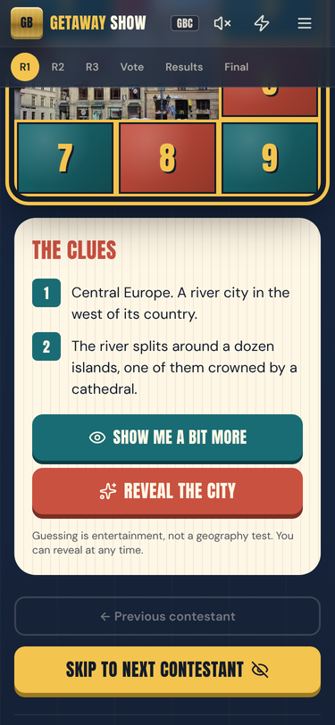
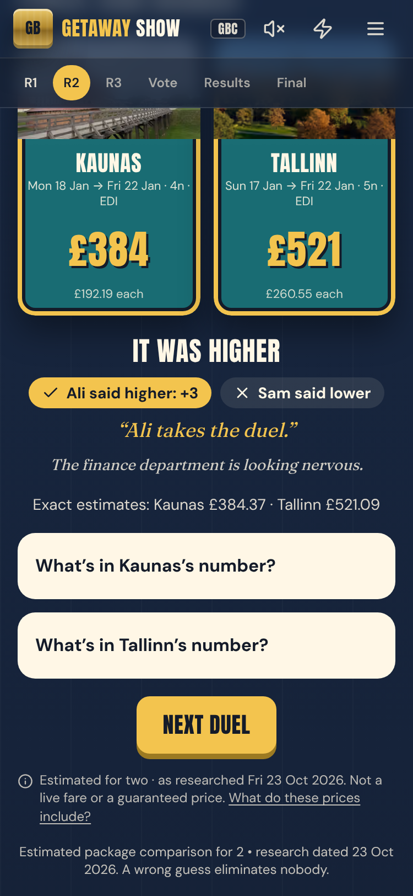
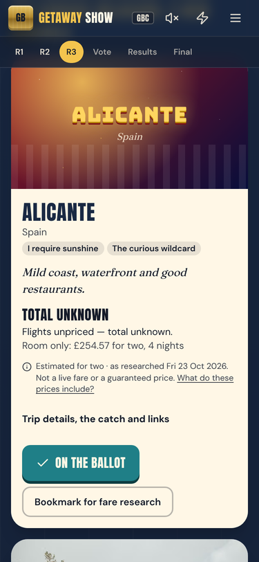
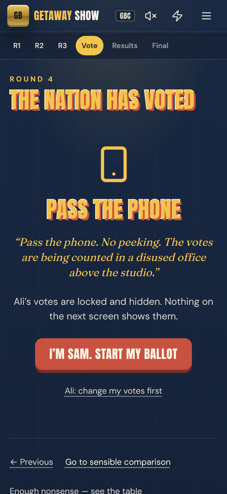
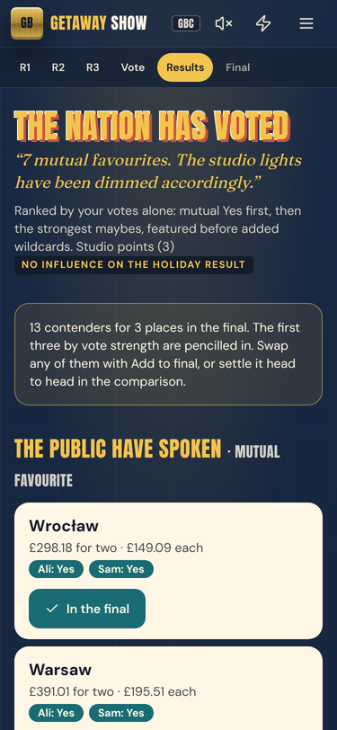
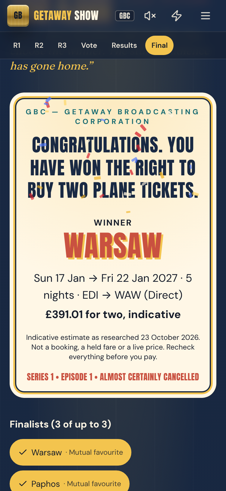

# Holiday Games

Three game-show front ends for choosing a January 2027 European break for two. All read the same researched spreadsheet, so they always show the same prices.

- The Great January Getaway (`/january-getaway`) is a tongue-in-cheek Saturday-night prize show: conveyor belt, guess the price, Keep / Maybe / Bin and a Grand Final.
- Blind Flight (`/blind-flight`) is a retro dating-show parody. Destinations flirt, drop clues and reveal themselves, then two travellers vote in private on one phone and the matches are revealed together.
- The Great British Getaway Show (`/getaway-show`) is a late-1980s Saturday-evening game-show parody: a tile-flip picture reveal, higher-or-lower price duels, a dartboard of wildcards, private two-person ballots and a grand final.

All prices are indicative totals for two, observed on 23 October 2026. They are not live fares. Every price and link needs rechecking before you book.

## Games on this site

The home page (`/`) lists every game. The January Getaway lives at `/january-getaway`, Blind Flight at `/blind-flight` and the Getaway Show at `/getaway-show`.

To add a game, give it its own folder under `src/app/` and add an entry to `src/lib/games.ts`. Set `comingSoon: true` to show it on the home page before it is playable.

## Running it locally

You will need Node 20 or later.

```bash
npm install
npm run dev          # http://localhost:3000
npm test             # data and logic checks
node tests/e2e/getaway-show.smoke.cjs   # browser play-through; needs `npm start` running and Playwright installed
npm run typecheck
npm run build        # production build, as Vercel runs it
```

## Where the data lives

| File | What it holds | How it changes |
|---|---|---|
| `data/source/January_2027_Europe_Holidays_Updated_Flexible_Flight_Times.xlsx` | The authoritative workbook | Replace it with a newer version |
| `src/data/assumptions.json` | Baggage per adult, transfers for two, observation date, travel window | Edit by hand |
| `src/data/itineraries.json` | Every flight-and-room combination, normalised | **Generated** by `npm run import-data`. Do not edit by hand |
| `src/data/destinations.ts` | Intros, highlights, cautions, typical January weather, photo paths, and which destinations appear in the show | Edit by hand |
| `src/data/imageCredits.json` | Photographer and licence for each photo | Edit when you change a photo |
| `public/images/destinations/` | Destination photographs (Wikimedia Commons) | Add or replace JPEGs |

The importer reads two sheets:

- `Viable itineraries`: 20 priced trips and 25 scheduled but unpriced trips.
- `Connections to verify`: 16 destinations with a room quote but no established flights.

It recomputes each total as (fare per person × 2) + room + (baggage × 2) + transfers. It then checks the result against the workbook's own `With extras / two` column and warns about any mismatch. At present all 20 match to the penny.

A total is only produced when the workbook has a fare for those exact dates. Anything else has a null total. The site then shows "Flight price not verified" or "Needs manual review" and never borrows a price from another itinerary.

### Updating a price

1. Edit the fare or room cell in the workbook's `Viable itineraries` sheet, or drop in a new workbook with the same sheet layout.
2. Run `npm run import-data`.
3. Run `npm test`. One test asserts that the recomputed totals equal the workbook's totals, so it will flag an edit made in only one place.
4. Update `pricesObservedOn` in `src/data/assumptions.json` if the observation date has changed.

### Changing the extras assumptions

Edit `baggagePerAdultGBP` or `transfersForTwoGBP` in `src/data/assumptions.json`, then run `npm run import-data`. The importer will warn that totals now differ from the workbook. That is expected. The data test will also fail until the workbook column agrees, which stops the two sources drifting apart without anyone noticing.

### Changing who is in the show

Each entry in `src/data/destinations.ts` has a `role`:

- `main`: on the conveyor belt and in the price round. The default itinerary must be priced; a test enforces this.
- `mystery`: the bonus round. These have no matched fare, so the reveal says "Flight price awaiting confirmation".
- `extra`: Sensible mode only.

The order of `main` entries is the order of the belt. A destination with several date or airport options gets one card with a date picker, not separate cards. Itineraries are attached automatically by `destinationId`. `preferredItineraryId` pins which one shows first; otherwise the cheapest priced option is used.

To add a destination, add a mapping in `DESTINATION_IDS` in `scripts/import-holiday-data.ts`, add an entry to `destinations.ts`, and rerun the importer.

### Photos

Photos come from Wikimedia Commons under CC BY, CC BY-SA or CC0 licences. Credits are shown on each photo and listed in the site footer. If a photo is missing or fails to load, the card shows a designed poster-style fallback instead.

## Blind Flight

The brief is in `docs/BLIND_FLIGHT_BUILD_BRIEF.md`.

### How a game runs

1. On the title screen you choose a two-person game (the default) or quick play, with optional nicknames.
2. The show has four episodes of three contestants. Each contestant gives a one-liner and three clues, then reveals its city, photo, reasons to go, "the awkward bit" and trip facts.
3. Priced trips have an optional price round. Unpriced trips say "Price pending — flights not yet priced" and show the room quote and timetable as separate facts.
4. You vote Keep, Maybe or Pass with buttons. Swiping right or left is a shortcut. Undo is always available.
5. In a two-person game, Traveller 1 locks in their ballot and passes the phone. Traveller 2 votes on the same contestants without seeing Traveller 1's votes.
6. Results group destinations into It's a Match! (Keep + Keep), Potential Match (Keep + Maybe, Maybe + Maybe), One of Us Has Questions (Keep or Maybe against Pass) and Mutual Rejection (Pass + Pass). A missing vote is never counted as a Pass. Anything can be reconsidered.
7. The grand final compares two to four finalists side by side. You pick the winner yourselves. You can copy, share or download a CSV summary, which leaves out nicknames.

Quick play has one shared ballot and produces a shortlist, never a "match".

"I refuse to participate in this nonsense" opens Sensible mode at `/blind-flight/holidays`. It lists every itinerary in the travel window with filters for budget, nights, airport, trip type, price status and route.

### Routes

| Route | Screen |
|---|---|
| `/blind-flight` | Title screen and mode choice |
| `/blind-flight/show` | Episode stage with three podiums per episode |
| `/blind-flight/show/[id]` | One contestant: clues, reveal, price round, vote |
| `/blind-flight/handover` | Pass the phone |
| `/blind-flight/results` | Match reveal |
| `/blind-flight/compare` | Grand final comparison |
| `/blind-flight/contenders` | More eligible contenders to add as a bonus round |
| `/blind-flight/holidays` | Sensible mode |
| `/blind-flight/about` | About these prices |

Every route works on reload, with Back, and when opened directly. Pages that depend on both ballots say so until both are in.

### Where things live

| File | What it holds |
|---|---|
| `src/blind-flight/data/profiles.ts` | Dating-show copy for each featured contestant: one-liner, three clues, pitch, awkward truth |
| `src/blind-flight/data/episodes.ts` | Episode titles, presenter lines and casts |
| `src/blind-flight/data/copy.ts` | Presenter copy bank and vote reactions |
| `src/blind-flight/lib/cast.ts` | Which trips can appear, variants per destination, episodes and cautions |
| `src/blind-flight/lib/cost.ts` | Price breakdown and the joke guess badges |
| `src/blind-flight/lib/voteMatching.ts` | The matching rules |
| `src/blind-flight/lib/state.ts` | Game state, actions and selectors |
| `src/blind-flight/lib/persistence.ts` | Saving to `localStorage`, with a schema version and clean-up on load |

Facts are not duplicated. Names, countries, photos, highlights, typical weather and cautions come from `src/data/destinations.ts`. Prices, dates, flights, hotels and links come from `src/data/itineraries.json`. Update a price once with `npm run import-data` and both games pick it up.

### Changing the cast

- To change who is featured, edit the `cast` arrays in `episodes.ts`. Each destination needs a profile in `profiles.ts` with three clues. A test checks this.
- A destination drops out of the show automatically if it has no trip in the travel window. An empty episode is skipped.
- Every other destination with an eligible trip appears under More eligible contenders. Adding one creates a bonus round. These arrive already revealed, with no clues.
- Trips from the `Connections to verify` sheet have no established flights. They appear in Sensible mode only.
- A destination with several date or airport options is one contestant with a "Pick your dates" switch. Switching resets the price round.

### Saved progress

State is saved under the `blind-flight:v2` key with `schemaVersion: 2`. On load, anything unreadable, from another schema version, or pointing at a destination that no longer exists is dropped. Use Reset the whole show in the footer, or Start again on the title screen.

Two-person voting works on one phone only. Nothing syncs between devices.

## The Great British Getaway Show

The brief is in `docs/GETAWAY_SHOW_BUILD_BRIEF.md`. It is broadcast on GBC, the Getaway Broadcasting Corporation, a fictional channel. Round names, artwork, lettering and presenter lines are original.

### How a game runs

1. The title screen offers Roll the titles, Skip the nonsense (the table) and What do these prices include?. A saved show offers Resume show and Start again.
2. Members of the audience: the two-person edition (default) or the quick edition, with optional nicknames.
3. Round 1, Catch a Flight. Twelve featured destinations, in a shuffled running order for each new show. Each hides a real photo under nine numbered tiles. Show me a bit more flips three tiles and adds a clue. Reveal the city works at any time. The info card gives three reasons, the catch, dates and flight evidence, and informal bookmarks. Optional studio points for early guesses.
4. Round 2, Play Your Flights Right. Six higher-or-lower duels along a price ladder of priced destinations. The ladder is shuffled for each new show, so different destinations meet in each duel. Every reveal shows the total for two, a breakdown and the research date. A wrong guess eliminates nothing.
5. Round 3, The Holiday Bullseye. Six board segments, picked by button or by Throw the dart. Each pick brings on one or two destinations not yet shown, drawn at random, or says All prizes claimed. Wildcards can be added to the ballot with Total unknown showing. More destinations lists everyone else.
6. Round 4, The Nation Has Voted. Traveller A votes Yes, Maybe or No, locks in and passes the phone. Traveller B votes without A's votes anywhere on screen. The results stay sealed until Reveal the results.
7. Results: The public have spoken (Yes + Yes), A grower, not a shower (Yes + Maybe, Maybe + Maybe), Controversy in the studio (Yes or Maybe against No), Did not make it past the auditions (No + No) and Not voted. A missing vote is never a No. Either ballot can be edited privately.
8. Grand final, Here's What You Could Have Flown. Up to three finalists side by side, ranked by votes. You can reorder by cheapest, simplest journey, most time there, winter escape or cafés and culture; anything that cannot be compared is labelled. You choose the winner, which produces a printable certificate. Print, Copy comparison and Copy the shortlist all work offline.

The quick edition has one shared ballot and gives Favourites, Maybes and Passes. It never calls anything a match.

Studio points, price duels and the dartboard never change the ranking. Only votes do.

Every stage has Previous, Skip round, Go to sensible comparison and Enough nonsense — see the table. The lightning button skips animations; the speaker button turns on optional sound.

### Routes

| Route | Screen |
|---|---|
| `/getaway-show` | Title screen and pre-show |
| `/getaway-show/catch-a-flight` | Round 1 |
| `/getaway-show/higher-or-lower` | Round 2 |
| `/getaway-show/bullseye` | Round 3 |
| `/getaway-show/vote` | Round 4: ballots and handover |
| `/getaway-show/results` | Results |
| `/getaway-show/final` | Grand final and certificate |
| `/getaway-show/holidays` | Every eligible itinerary, sortable and filterable |
| `/getaway-show/about` | What the prices include |

### Where things live

| File | What it holds |
|---|---|
| `src/getaway-show/data/contestants.ts` | Presenter setup, three clues, pitch and the catch for each featured destination; photo notes |
| `src/getaway-show/data/show.ts` | Broadcast groups, the price ladder, board segments and board tags |
| `src/getaway-show/data/copy.ts` | Presenter lines |
| `src/getaway-show/lib/cast.ts` | Which trips can appear, date variants, duel trips and board pools |
| `src/getaway-show/lib/cost.ts` | Price breakdown. Uses the workbook total once and never recomputes it |
| `src/getaway-show/lib/matching.ts` | The two-person outcome rules |
| `src/getaway-show/lib/state.ts` | Game state, actions and selectors |
| `src/getaway-show/lib/persistence.ts` | Saving to `localStorage` under `great-british-getaway-show:v3`, with clean-up on load |
| `src/getaway-show/lib/summary.ts` | Copy and share text |

Facts are shared with the other games. Names, countries, photos, highlights and typical weather come from `src/data/destinations.ts`. Prices, dates, flights, hotels and links come from `src/data/itineraries.json`.

### Changing the show

- To change the Round 1 cast, edit `broadcastGroups` in `show.ts`. Each featured destination needs a full entry in `contestants.ts`. A test checks that the clues never name the city.
- To change the price duels, edit `priceLadder`. Each card is compared with the one before it. Unpriced or repeated entries are dropped, so the number of duels follows the data.
- Board tags for "very old buildings", "possibly hypothermia", "I require sunshine" and "eat your way round" are in `boardTags`. "Cheap as chips" is worked out from prices (up to `CHEAP_CEILING_GBP`). "The curious wildcard" is every show destination with no priced trip.
- A destination with several date or airport options is one contestant with a Pick your dates switch. Changing dates resets any duel that destination is in. Votes stay.

### Screenshots

Taken at iPhone width (375 px) by the smoke test: `docs/screenshots/getaway-show/`.

| Title | Round 1 | Round 2 | Round 3 |
|---|---|---|---|
|  |  |  |  |

| Handover | Results | Grand final |
|---|---|---|
|  |  |  |

## Deploying to Vercel

The app is a standard Next.js 15 App Router project. It needs no environment variables, database or API keys.

1. Push this repository to GitHub.
2. In Vercel, choose **Add New → Project**, then import the GitHub repository.
3. Accept the detected Next.js settings and deploy.
4. Every pull request then gets a preview URL. The production branch deploys to the main URL.

## Saved progress

Each new game shuffles its running order: the conveyor belt and the mystery contestants here, and the Round 1 order, the Round 2 pairings and the board draws in the Great British Getaway Show. The shuffle is seeded and saved, so a refresh keeps the same order. It is fixed once anything has been judged or revealed. A game saved before shuffling existed keeps the workbook order until it is reset.

Guesses, decisions, the chosen dates, contestant names and settings are saved in the browser's `localStorage`. Nothing leaves the device. Progress survives a refresh but does not sync between phones. Use **Reset the whole show** in the footer to start again.

## Accessibility and motion

- Sound is off by default and is synthesised in the browser. No audio files are used.
- The belt respects the device's reduced-motion setting, and the sparkle button in the header overrides it either way. With reduced motion the belt does not run on its own, and you move through it with the arrow buttons or the arrow keys.
- All controls are buttons or form fields reachable by keyboard, with visible focus rings and 44 px touch targets.

## Known limitations

- Flight links in the workbook are mostly generic Skyscanner, Expedia route or FlightsFrom timetable pages, not dated deep links. The site labels them as such.
- Several priced fares were indexed or detailed quotes, not reconfirmed live availability. Flight times for most priced options were not recorded.
- Weather lines describe typical January climate from general knowledge. They are not forecasts.
- Points in the price round are entertainment only and do not rank the holidays.
- Independent voting on two phones, live fares and shared links are not built in any game.
- Eight unpriced Getaway Show wildcards (Santander, Istanbul, Alicante, Lanzarote, Gran Canaria, Barcelona, Geneva and Zurich) have no photo yet and use the designed poster fallback.
- The repository has no ESLint set-up, so there is no `npm run lint`. `npm run typecheck` and `npm run build` cover type and build errors.
- Blind Flight's clues and pitches are editorial copy checked against general knowledge, not against the workbook.
